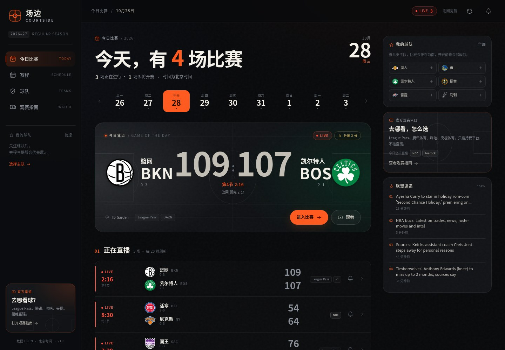
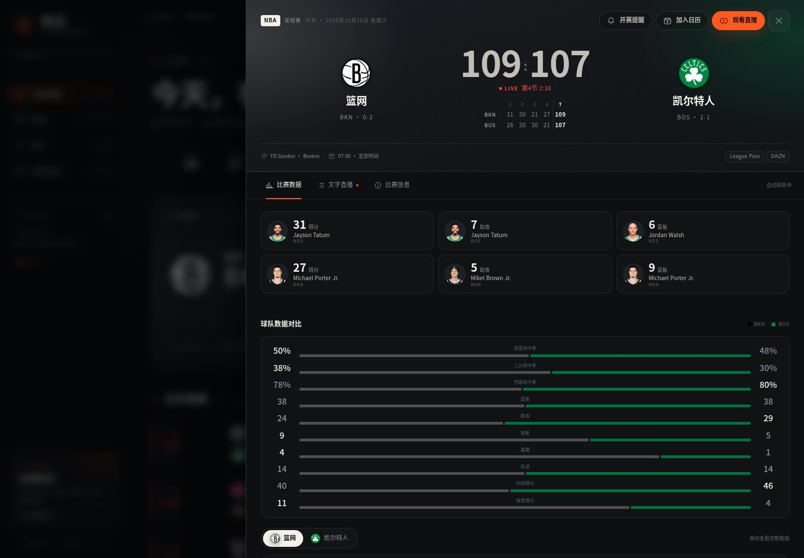
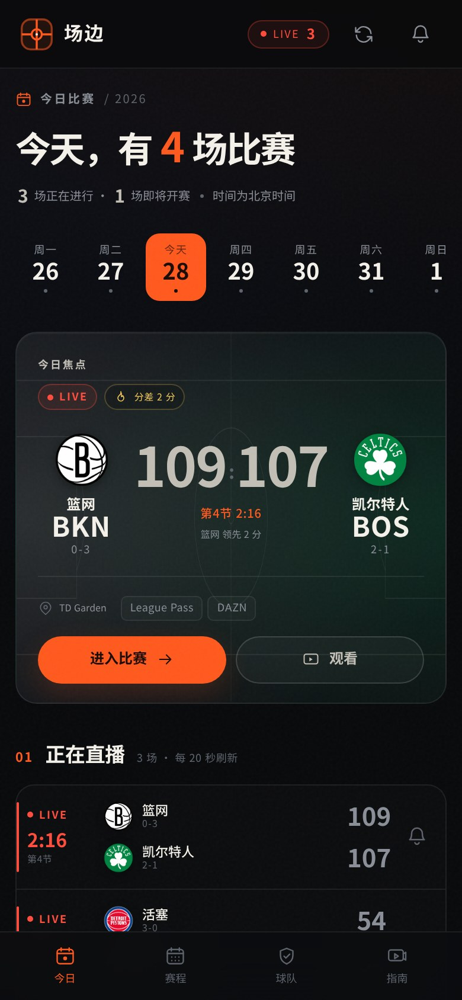

# 场边 COURTSIDE

> 每天，准时坐到场边。一个为 NBA 球迷做的每日比赛台：赛程、实时比分、比赛数据、开赛提醒，以及官方观赛入口。



## 为什么做它

每天想知道“今天有没有 NBA、几点打、在哪看”，通常要在赛程页、比分页、新闻和几个平台之间来回跳。场边把这些信息收进一个安静的界面里：

- 打开就知道今天有几场、谁在打、打到第几节；
- 点进一场比赛，能看技术统计、文字直播、伤病和球馆信息；
- 关注的球队会排在前面，开赛前可以用浏览器通知提醒你；
- 想看直播时，只引导到官方或持权平台，不碰来路不明的“源”。

## 功能

### 今日比赛
- 按**北京时间**整理当天全部比赛，自动处理 NBA 美国比赛日跨天的问题。
- 正在直播、即将开赛、已结束分组展示。
- 直播比分每 20 秒自动刷新，比分变化有轻微高亮。
- 今日焦点自动选择最胶着/最值得看的比赛。

### 比赛详情
- 实时比分、分节比分、球馆、转播方。
- 球员数据：首发/替补、分钟、得分、篮板、助攻、命中率、正负值。
- 球队数据对比：投篮、三分、罚球、篮板、助攻、抢断、盖帽、失误、内线得分、快攻。
- 文字直播：按节次倒序，支持“只看得分”。
- 赛前/赛后信息：伤病名单、赛季交手、裁判、上座人数、盘口（有数据时）、赛后速递。
- 一键导出 `.ics` 日历，支持 Apple Calendar / Google Calendar / Outlook。

### 我的球队与排名
- 东西部排名、战绩、胜率、胜差、近况、场均得分。
- 关注球队后，首页优先展示、开赛提醒默认生效。
- 球队主页：下一场/正在进行的比赛、未来赛程、近期战绩、球队数据。

### 提醒
- 浏览器通知：开赛前 5–120 分钟提醒、完场比分、关键比分（末节/加时 5 分以内）。
- 单场比赛可以单独点铃铛设置提醒。
- 所有偏好保存在本机 `localStorage`，不需要账号。
- 可安装为 PWA，从桌面直接打开。

### 观赛指南
- 本场官方转播方（来自 ESPN 节目信息）。
- 持权平台目录：NBA League Pass、腾讯体育、咪咕视频、央视体育、ESPN/ABC、Peacock。
- 黑屏、地区版权、League Pass 限制等常见问题。
- **不提供任何非官方直播源**，只做官方入口聚合。

## 截图

| 比赛详情 | 手机端 |
| --- | --- |
|  |  |

## 快速开始

要求：Node.js **20+**。没有数据库，也不需要安装 npm 依赖。

```bash
git clone git@github.com:kallcurry/NBA.git
cd NBA
npm start
```

打开 <http://127.0.0.1:4321>。

开发模式：

```bash
npm run dev
```

指定端口 / 监听地址：

```bash
PORT=8080 HOST=0.0.0.0 node server.mjs
```

## 设计说明

### 为什么是“场边”
界面不追求把联盟所有数据一次性铺开，而是模拟坐在场边的观看顺序：

1. **先看今天**：大标题、比赛数量、焦点战，三秒内知道今天值不值得熬夜。
2. **再看比分**：直播中的比赛用红色 LIVE、节次和倒计时抓住注意力。
3. **需要时再深入**：点开一场比赛才有完整技术统计和文字直播，避免首页信息过载。
4. **最后才是入口**：观赛渠道放在详情和独立指南里，不和比分抢注意力。

视觉上使用暖白文字、炭黑底色和篮球橙作为唯一强调色；球队颜色只作为低饱和光晕，避免变成“彩虹比分板”。数字使用 Barlow Condensed，中文使用系统中文字体，保证比分和长中文队名都清晰。

### 北京时间与 NBA 比赛日
NBA 官方比赛日按美国东部时间划分，而中国球迷说的“今天”是北京时间。比如美国时间 10 月 27 日晚上的比赛，北京时间是 10 月 28 日早上。

服务端会同时拉取目标日期前一个美国比赛日和当天的数据，再按 UTC 时间转换成的**北京日期**过滤、去重和排序。所有页面展示的时间都是 `Asia/Shanghai`。

### 实时比分
- 前端默认每 20 秒刷新一次；比赛详情页每 12 秒刷新。
- 服务端对 ESPN 响应做 9 秒缓存，避免多个标签页把请求打爆。
- 页面不可见时暂停轮询；恢复可见时立即补一次。
- 浏览器离线时展示最近一次成功缓存的比赛日快照。

### 提醒的现实边界
这是一个本地优先的网页应用，通知由页面里的定时检查触发：

- 需要浏览器通知权限；
- 需要页面保持打开（可以安装成 PWA 或固定标签页）；
- 浏览器完全退出后，本地提醒无法唤醒；
- 不收集、不上传任何个人数据。

如果要做“关掉网页也能收到推送”，需要服务端 Web Push（VAPID）和用户订阅，当前版本没有引入后端账号体系。

## 项目结构

```text
.
├── server.mjs                 # 零依赖静态服务器 + ESPN 数据代理 + 归一化
├── package.json
├── public/
│   ├── index.html             # 壳、SVG 图标 sprite
│   ├── manifest.webmanifest   # PWA
│   ├── sw.js                  # 应用外壳缓存（API 不缓存）
│   ├── css/styles.css         # 设计系统与响应式
│   ├── assets/                # 本地字体、图标
│   └── js/
│       ├── app.js             # 路由、轮询、交互、通知调度
│       ├── api.js             # 前端缓存 / 离线快照
│       ├── store.js           # 关注、提醒、设置持久化
│       ├── data.js            # 中文队名、平台、时间与颜色工具
│       ├── ui.js              # 通用 UI、弹层、Toast
│       ├── notifications.js   # 浏览器通知
│       ├── calendar.js        # .ics 导出
│       ├── components/        # 比赛卡片、比赛详情
│       └── views/             # 今日、赛程、球队、指南、设置
└── docs/                      # README 截图
```

## API

服务端把 ESPN 原始 JSON 归一化成前端友好的结构，并统一处理北京日期。

| 路径 | 说明 |
| --- | --- |
| `GET /api/health` | 健康检查 |
| `GET /api/scoreboard?date=YYYY-MM-DD` | 某个北京日期的比赛 |
| `GET /api/today` | 今天（北京时间）的比赛 |
| `GET /api/game?id=...` | 比赛详情、技术统计、文字直播、伤病 |
| `GET /api/teams` | 30 支球队 |
| `GET /api/standings` | 东西部排名 |
| `GET /api/team-schedule?team=ID` | 球队近期与未来赛程 |
| `GET /api/news` | ESPN NBA 新闻 |
| `GET /api/calendar` | 赛季比赛日（用于日历圆点） |

数据来源：[ESPN 公开 NBA API](https://site.api.espn.com/apis/site/v2/sports/basketball/nba/scoreboard)。本项目不是 ESPN 或 NBA 的官方产品。

## 部署

### 直接运行

```bash
HOST=0.0.0.0 PORT=4321 npm start
```

### Docker

```bash
docker build -t courtside .
docker run --rm -p 4321:4321 courtside
```

> 提醒：部署到 HTTPS 域名后，浏览器通知和 PWA 安装才能完整工作。`localhost` 也被视为安全上下文。

## 数据与版权

- 比赛、比分、统计、新闻来自 ESPN 的公开接口，仅用于个人学习与信息聚合。
- 球队标识、球员头像、新闻图片版权归 NBA、ESPN 及各权利人所有。
- “观看”入口只指向 NBA、ESPN、NBC、Peacock、腾讯体育、咪咕视频、央视体育等官方或持权平台。
- 本项目**不收录、不托管、不推荐任何非官方直播源**。请通过持权平台观看比赛。
- 本项目不是 NBA、ESPN 或任何转播平台的官方产品。

## Roadmap

- [ ] Web Push，实现关掉网页后的提醒
- [ ] 球员搜索与球员主页
- [ ] 更完整的赛季数据榜（得分/篮板/助攻）
- [ ] 多语言（English）
- [ ] 接入第二个数据源做容灾
- [ ] 可选的“仅看我的球队”首页模式

## License

MIT
